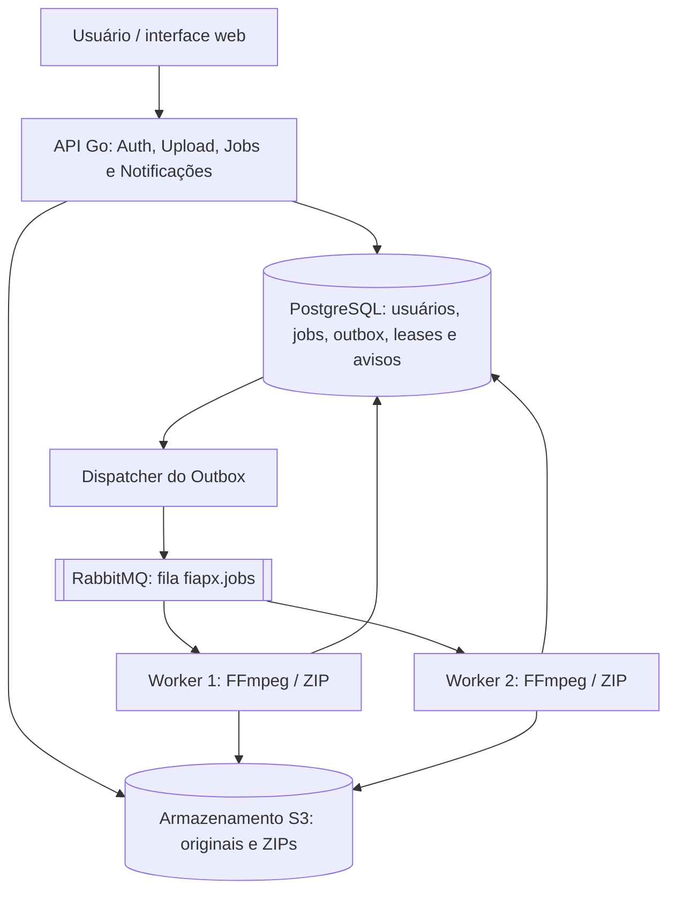

# FIAP X — Arquitetura e justificativas

## Contexto

O código-base da FIAP era um único servidor Go/Gin, realizando upload e FFmpeg na mesma requisição e gravando ZIP no disco local. O projeto final preserva a extração de imagens a 1 FPS, mas separa a **aceitação das solicitações** do processamento que consome CPU. A abordagem evita manter conexões HTTP abertas durante o processamento e permite aumentar a quantidade de workers.

## Componentes

**API (Go `net/http`):** autenticação por usuário/senha com bcrypt, JWT de 1 hora, upload multipart limitado a 100 MiB, consulta própria, download ZIP autorizado, interface web e notificações. A API não realiza FFmpeg.

**Worker (Go + FFmpeg):** consome RabbitMQ, obtém vídeo privado, extrai PNGs (`fps=1`), cria ZIP, grava o resultado, atualiza estado e tenta novamente quando a infraestrutura falha. Workers são executáveis separados e podem ser escalados com Docker Compose.

**PostgreSQL:** transações locais e integridade dos usuários, trabalhos, outbox e notificações. A mesma transação que marca uma falha terminal persiste o aviso do usuário e a intenção de entrega de e-mail. O estado não depende de memória do processo.

**RabbitMQ:** isolamento entre upload e execução e tolerância a picos. Fila durável, mensagens persistentes, confirmação de publicação e ACK somente após gravar o resultado no banco. `prefetch=1` limita a um job por consumidor.

**Armazenamento S3 compatível:** vídeo e ZIP fora do banco, separados por chaves de usuário e job. No Compose, o serviço Silo fornece API compatível com a biblioteca MinIO Go. Os objetos não são publicados por rotas estáticas; a API valida propriedade antes de abrir o ZIP.

## Fluxo de dados e consistência

1. Usuário autenticado envia vídeo; a API armazena o arquivo e grava `video_jobs` + `video_job_outbox` na mesma transação. Retorna 202 somente depois do commit.
2. Um dispatcher lê a outbox com `FOR UPDATE SKIP LOCKED`, publica uma mensagem com apenas o ID do job e registra publicação após confirmação do RabbitMQ.
3. O worker obtém uma `lease_token` exclusiva no PostgreSQL, alterando o job para `processing`. Mensagens duplicadas não conseguem processar o mesmo job simultaneamente. A lease é renovada por heartbeat.
4. FFmpeg extrai quadros e o worker salva o ZIP no S3. Só então grava `completed` no banco e confirma a mensagem. Download exige JWT e `user_id` correto na consulta SQL.
5. Falha na decodificação é terminal. Indisponibilidade transitória tenta novamente até o limite de três tentativas. Na falha definitiva, o estado `failed` e uma notificação `processing_failed` são gravados atomicamente; o índice único impede avisos repetidos.
6. Ao reiniciar um worker que caiu, a mensagem não confirmada é reentregue. Depois da expiração da lease, outro worker pode reivindicar a execução. O token de fencing impede que a execução antiga finalize um job cujo controle perdeu.

## Notificações por e-mail (SMTP)

Na falha terminal, o worker persiste **status `failed` + notificação in-app + intenção de e-mail** na mesma transação PostgreSQL. A tabela `notification_email_outbox` tem chave única para `notification_id`; um dispatcher assíncrono na API consulta lotes com `FOR UPDATE SKIP LOCKED`, envia ao SMTP e grava confirmação do relay. Falhas geram tentativas limitadas com backoff, sem interromper uploads/processamento.

O overlay Compose `docker-compose.mail.yml` oferece Mailpit para demonstração em `http://localhost:8025/`, com SMTP com TLS implícito e certificado de demonstração confiável somente dentro do Compose. Para um relay real, `SMTP_HOST`, `SMTP_PORT`, `SMTP_FROM` e eventuais credenciais são configurados fora do Git; **TLS implícito com validação de certificado e hostname é obrigatório** (porta padrão 465, sem fallback para STARTTLS). Sem SMTP, os avisos in-app continuam disponíveis e os emails ficam pendentes até configuração.

A garantia é de **pelo menos uma entrega ao relay**; o cliente final pode não receber (rejeição, spam ou bounce) e há risco de duplicidade após uma falha entre confirmação SMTP e commit. A verificação de propriedade dos endereços de email não foi implementada nesta entrega de demonstração.

## Observabilidade e monitoramento

O projeto inclui um perfil opcional `monitoring` com **Prometheus** (coleta de métricas e avaliação de alertas) e **Grafana** (dashboard já provisionado via arquivos versionados).

- **API:** listener separado em `:9091`, disponível apenas na rede Docker. Métricas agregadas de `video_jobs` (estados, tentativas e idade), `video_job_outbox` pendente e notificações não lidas. Nenhuma identificação de usuário é exportada.
- **Broker e workers:** o plugin nativo `rabbitmq_prometheus` expõe número de consumidores, fila pronta, mensagens sem ACK e profundidade da fila, permitindo verificar workers ativos e detectar gargalos.
- **Prometheus:** scrape a cada 5 segundos, retenção local de 3 dias e regras para indisponibilidade, falta de consumidores e atraso de fila/outbox.
- **Grafana:** dashboard FIAP X | Operations sem configuração manual, com métricas de disponibilidade, backlog, falhas e status.
- **Escopo dos alertas:** regras são avaliadas e visíveis no Prometheus, mas **não há envio externo por e-mail/Slack** porque não configuramos Alertmanager ou contact points. O sistema é de monitoramento, não uma plataforma de incidente on-call.

## Escolhas e trade-offs

**Dois executáveis em um repositório**, em vez de múltiplos microsserviços de negócio: respeita responsabilidades e escalabilidade sem adicionar infraestrutura desnecessária. O desafio não exige Saga nem múltiplos bancos.

**Docker Compose em vez de Kubernetes:** permitido para a entrega, suficiente para demonstrar duas réplicas de worker, picos e recuperação. Adotar Kubernetes acrescentaria complexidade operacional sem necessidade explícita.

**Notificações in-app e por e-mail:** o aviso privado é persistido junto com a falha. A API oferece `GET /api/notifications` e confirmação de leitura, enquanto o outbox de e-mail permite envio SMTP assíncrono e recuperável. O Mailpit comprova a entrega ao relay sem exigir uma conta externa.

**Limites conhecidos:** os **alertas operacionais do Prometheus** não enviam notificações externas, pois não há Alertmanager configurado; isso é distinto dos **e-mails de falha dos vídeos**, enviados por SMTP opcional (Mailpit na demo). As métricas não substituem tracing distribuído nem logs centralizados. Volumes Docker locais não substituem backup/alta disponibilidade; um upload persistido cujo commit no PostgreSQL falha pode deixar objeto órfão; o retry de vídeo não possui DLQ dedicada; não há deploy remoto automático. Essas decisões reduzem escopo sem esconder as limitações.

## Evidências automatizadas

- `scripts/smoke-intake.sh`: aceita upload mesmo após parar RabbitMQ e demonstra reenfileiramento.
- `scripts/smoke-email.sh`: verifica email capturado pelo Mailpit, falha do servidor SMTP e reenvio após recuperação.
- `scripts/smoke-processing.sh`: processa dois vídeos reais com workers paralelos, confere ZIP, acesso por usuário, duplicidade e falha terminal, consulta notificação privada, confirma leitura e recupera uma lease simulada como expirada.
- `.github/workflows/ci.yml`: executa testes Go com race detector e perfil de cobertura (`coverage.out` e `coverage-summary.txt` como artifact), quatro E2E (intake, processamento, monitoramento, e-mail), e valida que Prometheus/Grafana capturam métricas reais.
- `.github/workflows/ci.yml`: o job `publish` publica imagens no GHCR somente após todos os jobs de validação concluírem com sucesso, em um `push` para `main`; o token com escrita em pacotes é limitado a esse job.

Veja [matriz de requisitos](requirements.md) e [roteiro de demonstração](demo.md).
